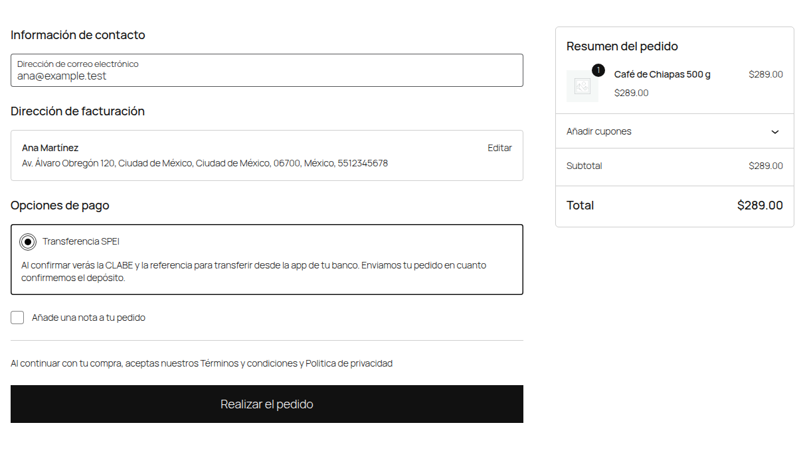

# SPEI México para WooCommerce (gratis)

Cobra por **transferencia SPEI a tu CLABE** en tu tienda WooCommerce, sin comisiones de pasarela.
Plugin de WordPress gratuito y de código abierto (GPLv2 o posterior), hecho en México por [Lion Systems](https://www.lionsystems.com.mx/plugins/spei-woocommerce?utm_source=github&utm_medium=readme&utm_campaign=spei-gratis).



## Por qué

WooCommerce trae «Transferencia bancaria directa», pero está pensada para IBAN y SWIFT. En México se paga por SPEI a una CLABE de 18 dígitos. Este plugin agrega un método de pago hecho para ese flujo.

## Qué hace

**Para tus clientes**
- Datos de pago claros en la página de «Pedido recibido» y en el correo: banco, beneficiario, CLABE, monto exacto y concepto.
- Botón «Copiar» junto a cada dato, para pegarlo en la app del banco sin errores.
- Concepto y referencia numérica basados en el número de pedido.
- Formulario «Ya pagué» donde el cliente captura su clave de rastreo SPEI.

**Para tu tienda**
- Valida el dígito verificador de tu CLABE al guardarla.
- Pedidos «En espera» con inventario apartado.
- Cancelación automática de pedidos no pagados a las horas que elijas (48 por omisión), liberando inventario.
- Si el cliente ya reportó su pago, el pedido no se cancela y te llega un correo.
- Caja en el pedido con lo necesario para verificar la transferencia en el CEP de Banxico.
- Checkout por bloques y clásico; compatible con HPOS.
- En inglés, con traducción incluida a español de México y de España.

## Instalación

1. Descarga el ZIP desde [Releases](../../releases) o desde [lionsystems.com.mx](https://www.lionsystems.com.mx/plugins/spei-woocommerce?utm_source=github&utm_medium=readme&utm_campaign=spei-gratis).
2. En WordPress: **Plugins → Añadir nuevo → Subir plugin** y actívalo.
3. **WooCommerce → Ajustes → Pagos → Transferencia SPEI**: captura banco, beneficiario y CLABE.

Requisitos: WordPress 6.5+, WooCommerce, PHP 7.4+ y moneda MXN.

## ¿Quieres que los pagos se confirmen solos? → SPEI México Pro

La versión gratuita deja todo listo para que verifiques cada transferencia a mano en el CEP de Banxico.
**SPEI México Pro** compara el comprobante CEP de Banxico contra el pedido (monto, CLABE, fecha y clave de rastreo) y lo marca como pagado sin que lo revises uno por uno; impide que una misma transferencia pague dos pedidos.

**$800.40 MXN al año (IVA incluido), licencia por tienda.** Factura disponible.
👉 [Ver SPEI México Pro](https://www.lionsystems.com.mx/plugins/spei-woocommerce?utm_source=github&utm_medium=readme&utm_campaign=spei-pro)

¿Necesitas ayuda para instalarlo o adaptar tu tienda? Escríbenos a soporte@lionsystems.com.mx.

## Desarrollo

```bash
docker run --rm -v "$PWD":/app -w /app php:8.3-cli php tests/clabe-test.php   # prueba de la CLABE
bin/empaquetar.sh                                                              # genera el ZIP instalable
```

Reportes de errores y propuestas: [Issues](../../issues).

---

# SPEI Mexico for WooCommerce (free) — English

Accept **SPEI bank transfers to your Mexican CLABE** in WooCommerce with no gateway fees: clear payment instructions with copy buttons, CLABE validation, automatic cancellation of unpaid orders, and an "I already paid" form with the SPEI tracking key. Free and open source (GPLv2+).

Need automatic payment confirmation against Banxico's CEP? See [SPEI Mexico Pro](https://www.lionsystems.com.mx/plugins/spei-woocommerce?utm_source=github&utm_medium=readme&utm_campaign=spei-pro).
